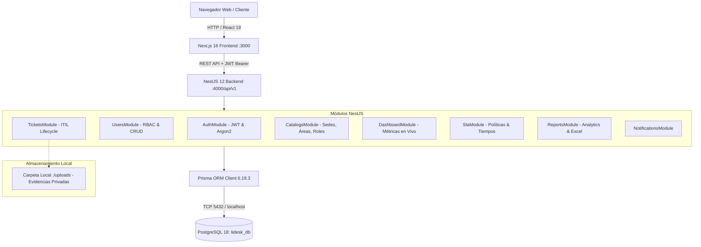

# 01_DIAGNOSTICO_GENERAL.md
# AUDITORÍA INTEGRAL DE ARQUITECTURA Y ESTADO REAL DE TIDESK
**Universidad Nacional de Cañete (UNDC)**

---

## 1. Resumen Ejecutivo
TIDESK es un sistema web monorepo full stack para la gestión integral de servicios TI y Mesa de Ayuda de la Universidad Nacional de Cañete, basado en buenas prácticas ITIL e inspirado en soluciones corporativas como GLPI y ManageEngine ServiceDesk Plus.

### Puntos Fuertes Detectados:
- Base de datos relacional sólida en **PostgreSQL 18** (`tidesk_db`) con 24 tablas mapeadas meticulosamente en Prisma ORM.
- Backend en **NestJS 12** con TypeScript estricto, arquitectura modular, autenticación segura con **Argon2** y tokens **JWT**, validación con `class-validator`, y documentación activa con Swagger UI.
- Frontend en **Next.js 16 (App Router)** con React 19, Tailwind CSS y componentes estilizados de alta calidad orientados a la identidad visual de la UNDC.

### Brechas Críticas Detectadas (Focos de Intervención):
1. **Gestión Dinámica de Usuarios:** El backend posee endpoints `POST /users`, `GET /users`, `PATCH /users/:id` y `PATCH /users/:id/toggle-status`, pero el formulario del frontend no cuenta con selector dinámico de Facultad, Carrera y Área según el rol seleccionado, ni edición de usuarios desde el modal.
2. **Adjuntos y Evidencias:** La tabla `adjuntos` existe en PostgreSQL/Prisma, pero **no existía el controlador ni servicio de subida/descarga de archivos con Multer en el backend**, ni el componente de carga (Dropzone/archivos) en el frontend.
3. **Bandeja de Tickets estilo GLPI:** Las bandejas operativas poseen filtros básicos, pero requieren ordenamiento inteligente, filtros avanzados predefinidos (Mis tickets, Sin asignar, Vencidos, Críticos) y visualización enriquecida de SLA.
4. **Flujos ITIL (REQ, INC, CRQ):** La lógica de aprobación CAB y resolución está programada en el backend, pero faltaba conectar la interfaz de evidencias en el ciclo de vida.

---

## 2. Pila Tecnológica Real

| Componente | Tecnología | Versión Instalada |
| :--- | :--- | :--- |
| **Runtime** | Node.js | v24.11.1 / npm 11.6.2 |
| **Base de Datos** | PostgreSQL (Windows x64) | 18 |
| **ORM** | Prisma ORM | 6.19.3 |
| **Backend** | NestJS | 12.0.1 |
| **Seguridad Backend** | Passport, JWT, Argon2 | @nestjs/jwt 12.0.2, argon2 0.45.1 |
| **Frontend** | Next.js (Turbopack) | 16.4.0 |
| **Librería UI** | React / React-DOM | 19.2.4 |
| **Iconografía** | Lucide React | 1.16.0 |
| **Generación Excel** | ExcelJS | 4.4.0 |

---

## 3. Diagrama de Arquitectura Real

---

## 4. Diferencias entre Diseño Teórico e Implementación Encontrada

| Elemento | Diseño Inicial | Estado Encontrado | Acción Requerida |
| :--- | :--- | :--- | :--- |
| **Base de Datos** | PostgreSQL 17/18 | PostgreSQL 18 activo y sincronizado (`tidesk_db`) | Mantener intacta |
| **Subida de Archivos** | Módulo de evidencias | No implementado en API ni Web | Implementar módulo completo de adjuntos |
| **Formulario Usuarios** | Roles adaptativos (Facultad / Área) | Formulario estático básico (solo Sede) | Adaptar dinámicamente según rol |
| **Filtros GLPI** | Vistas rápidas (Sin asignar, Vencidos) | Filtro por tipo/estado simple | Incorporar pestañas inteligentes en tickets |
