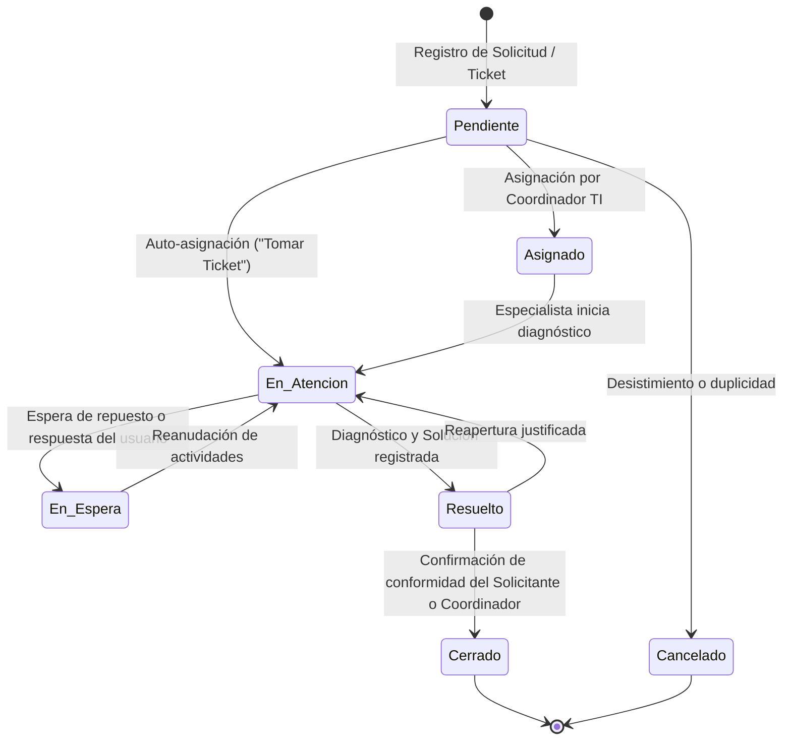

# 05_FLUJOS_REQUERIMIENTOS_INCIDENTES_CRQ.md
# FLUJOS DE CICLO DE VIDA ITIL: REQ, INC Y CRQ
**Universidad Nacional de Cañete – TIDESK**

---

## 1. Ciclo de Vida General del Ticket

---

## 2. Flujo de Requerimientos de Servicio (REQ)
- **Objetivo:** Provisión de accesos, software institucional, creación de cuentas (@undc.edu.pe, Teams) y apoyo en equipos.
- **Actores:** Solicitante (Docente, Estudiante, Administrativo) → Mesa de Ayuda TI.
- **Puntos de Control:**
  1. Selección de servicio y categoría en el catálogo.
  2. Adjuntar oficio o sustento de requerimiento (PDF/imágenes).
  3. Ejecución técnica y entrega de credenciales.
  4. Cierre y calificación de calidad (CSAT).

---

## 3. Flujo de Gestión de Incidentes (INC)
- **Objetivo:** Restauración rápida de la operatividad ante fallas de hardware, caídas de red, problemas en proyectores o servidores.
- **Cálculo de Prioridad:**
  - **Urgencia** (Alta, Media, Baja) × **Impacto** (Alto, Medio, Bajo) determina automáticamente la Prioridad (Crítica, Alta, Media, Baja) y el temporizador SLA.
- **Puntos de Control:**
  1. Registro inmediato con evidencia de error (captura de pantalla, foto física del equipo).
  2. Notificación prioritaria al equipo de soporte.
  3. Diagnóstico y aplicación de solución temporal (workaround) o definitiva.
  4. Registro en el historial del ticket.

---

## 4. Flujo de Gestión de Cambios (CRQ)
- **Objetivo:** Control y autorización de modificaciones significativas en la infraestructura tecnológica (actualización de servidores, mantenimiento de enlaces, cambios de cortafuegos).
- **Actores:** Especialista TI Solicitante → Comité de Cambios (CAB: Coordinador TI y Administrador).
- **Requisitos Obligatorios del Formulario CRQ:**
  1. Tipo de trabajo y ventana programada (Fecha, Hora inicio, Hora fin estimada).
  2. Nivel de riesgo e impacto en campus.
  3. Plan de trabajo técnico.
  4. Plan de pruebas post-implementación.
  5. Plan de reversa (Rollback de contingencia).
- **Votación CAB:**
  - El Coordinador o Administrador emite voto formal de Aprobación o Rechazo con justificación antes de que el cambio pueda ejecutarse.
